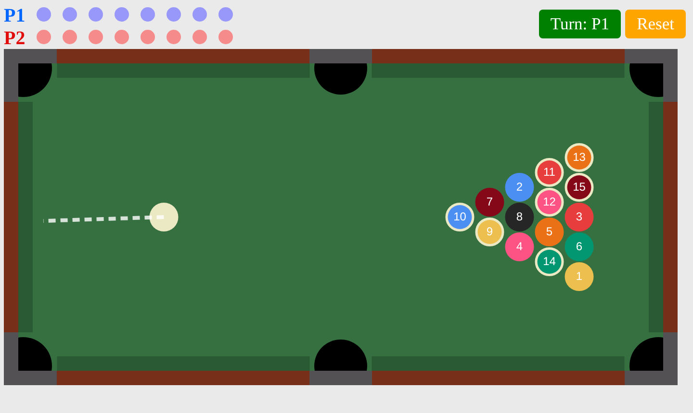
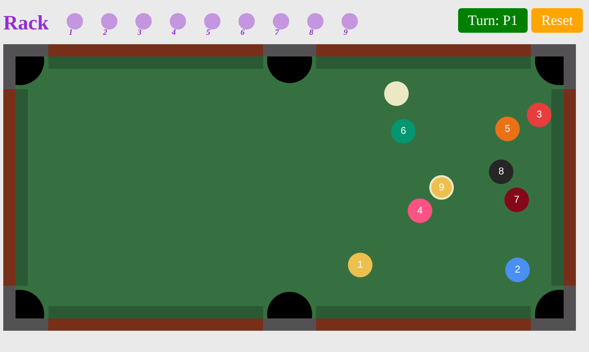

# billiard_HTML

> A two-player pool game in the browser, with 8-ball and 9-ball rules, built on the Matter.js physics engine.



**Part of [phamduylong.com](https://phamduylong.com)** · `type: personal` · `status: in progress` · `started: June 2025`

---

## Why I built it

[thephysiclab](https://thephysiclab.io.vn/) is a set of sports simulations that teach physics, and one of them is a pool table. I liked the pool mechanics, so in June 2025 I branched off on my own and started building it into a full game with real rules.

## Before → after

| Before | After |
| --- | --- |
| A pool table in a set of physics simulations | A standalone two-player game with 8-ball and 9-ball rules, a scoreboard and a winner screen |

## What it does

- **Start screen** with a choice of 8-ball or 9-ball.
- **8-ball:** a randomly shuffled 15-ball rack with the 8 in the middle. Solids and stripes are assigned on the first pot, and each player's progress shows as a row of dots.
- **9-ball:** a diamond rack with the 1 at the front and the 9 in the centre, and a tracker for which balls have gone down.
- **Turns** switch automatically once every ball has stopped moving.
- **Scratching** puts the cue ball back on its spot and passes the turn.
- **Winner screen** for Player 1 or Player 2, with a button to play again. A **Reset** button re-racks at any time.

## How to play

Press on the cue ball and drag **away** from where you want to shoot, like a slingshot. A dashed line shows the shot. The longer the drag, the harder the shot, up to a maximum. Let go to shoot.

**8-ball rules in this version**
- The first ball potted decides the groups. The shooter gets whichever type went down more (solids if it's a tie).
- You keep your turn while you pot your own group. Potting nothing, potting only the other group's balls, or scratching passes the turn.
- Pot the 8 after clearing all seven of your group, without scratching, to win. Pot it any earlier, or scratch on it, and you lose.

**9-ball rules in this version**
- Potting any ball keeps your turn. Potting nothing passes it.
- Pot the 9 without scratching to win.
- If you scratch, the turn passes. If the 9 went down on that shot, it goes back on its spot.

## How it works

The table runs on Matter.js with gravity switched off, so the balls only move when they're hit.

- **Table:** the cushions are static rectangles. The six pockets are static *sensor* circles: balls pass through them instead of bouncing, and a `collisionStart` event between a ball and a sensor counts as a pot.
- **Ending a shot:** after each physics step, the game checks whether every ball has slowed below a small speed threshold. Once they have, it processes the shot exactly once (tracked with a shot ID and a 500 ms gap), then decides whose turn it is or who has won.
- **Shooting:** the cue ball gets a velocity along the aim line, with a speed proportional to the drag length and capped so a shot can't break the physics.
- **The rack:** it's built column by column from a shuffled list of ball numbers. Striped balls are drawn with a white border, so they use a slightly smaller radius to look the same size as the solids.

## Built with

`HTML` · `CSS` · `JavaScript` · [`Matter.js 0.19.0`](https://brm.io/matter-js/) (loaded from a CDN)

## Run it

No build step. Clone the repo and open `index.html` in a browser:

```bash
git clone https://github.com/pdlong-09/billiard_HTML.git
cd billiard_HTML
open index.html        # macOS. On Windows, double-click the file.
```

Matter.js loads from cdnjs, so you need an internet connection the first time.

## Project structure

```
billiard_HTML/
├── index.html        start screen: choose 8-ball or 9-ball
├── 8ball.html        8-ball game
├── 9ball.html        9-ball game
├── p1win.html        Player 1 wins screen
├── p2win.html        Player 2 wins screen
├── logo.png, 8ball.png, 9ball.png   start screen art
└── docs/             screenshots for this README
```

## What I learned

[Long: 2–3 sentences in your own words. For example, what was harder than you expected, what you rebuilt, or what you'd do differently now.]

## Limitations

- **9-ball doesn't enforce hitting the lowest-numbered ball first**, so any ball can be played at any time.
- **8-ball doesn't check which group the cue ball hits first**, and there are no called pockets.
- **The cushions are slightly bouncier than real ones.** In 8-ball, restitution is set a little above 1, so collisions add a small amount of energy.
- **The table is a fixed 1400 × 700 canvas** and works with a mouse only, not touch, so it doesn't fit small screens.
- **Two players share one computer.** There's no online play or computer opponent.

## Credits

The starting point for the pool mechanics was the billiards simulation in [thephysiclab](https://thephysiclab.io.vn/). Physics by [Matter.js](https://brm.io/matter-js/) (MIT licence).



---

<sub>Phạm Duy Long · Hà Nội · [phamduylong.com](https://phamduylong.com)</sub>
